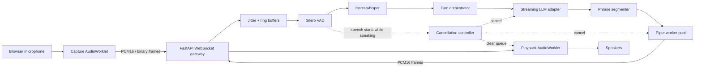

# SonicAgent

> **Repository scaffold:** this archive contains the complete project structure, interfaces, configuration, CI templates, documentation map, tests, examples, and implementation placeholders. Model inference and production hardening are intentionally marked as TODOs.

SonicAgent is an open-source, server-side real-time voice-agent gateway designed to receive microphone audio over a binary WebSocket, detect speech, transcribe locally, stream an LLM response, synthesize stable phrases with Piper, and return PCM audio while supporting interruption and cancellation.

<p align="center">
  
</p>

## Project status

| Area | Scaffold | Reference implementation | Production ready |
|---|---:|---:|---:|
| Repository architecture | ✅ | ✅ | — |
| Binary protocol definitions | ✅ | Partial | No |
| FastAPI application | ✅ | Minimal | No |
| Browser client | ✅ | Minimal | No |
| Silero VAD | ✅ | Placeholder | No |
| faster-whisper STT | ✅ | Placeholder | No |
| LLM providers | ✅ | Mock included | No |
| Piper TTS | ✅ | Placeholder | No |
| Barge-in | ✅ | Interfaces only | No |
| Benchmarks and telemetry | ✅ | Synthetic skeleton | No |
| Containers and deployment | ✅ | Development baseline | No |

The repository is deliberately honest about its maturity. Do not publish latency claims from this scaffold. Replace placeholders, run the real-model benchmark suite, document hardware, and complete the security checklist before production use.

## Target capabilities

- Binary PCM16 microphone and assistant audio over one WebSocket.
- Authenticated, resumable sessions with sequence numbers and heartbeat events.
- Server-side Silero VAD with configurable endpointing and pre-roll.
- Local speech recognition through faster-whisper.
- OpenAI-compatible and Ollama text-generation adapters.
- Stable phrase segmentation and pipelined Piper synthesis.
- Cooperative cancellation across LLM, TTS, playback, and queued audio.
- English and Italian model profiles.
- Per-stage latency metrics, traces, reproducible benchmarks, and regression checks.
- Bounded queues, payload limits, origin controls, log redaction, and privacy defaults.

## Architecture



### Data plane

The initial protocol uses 20 ms PCM signed 16-bit little-endian frames. At 16 kHz mono, each frame contains 320 samples and 640 payload bytes. JSON text frames carry control events; binary frames carry audio.

### Control plane

A session progresses through explicit states:

```text
created → connecting → listening → transcribing → thinking → speaking
                                  ↘ interrupted → listening
                                  ↘ error → closing → closed
```

Each turn has a unique identifier and cancellation token. Old or cancelled turn output must never be played after a new turn begins.

## Repository layout

```text
src/sonicagent_rt/      Python service and provider interfaces
clients/web/            Browser AudioWorklet reference client
clients/python/         Python SDK scaffold
model_registry/         Voice/STT manifests, schemas, and checksums
benchmarks/             Stage, end-to-end, and concurrency benchmarks
configs/                Layered application profiles
deploy/                 Docker, proxy, and observability templates
docs/                   Architecture, protocol, ADRs, runbooks, security
examples/               Minimal browser and Python examples
tests/                  Unit, contract, integration, E2E, performance tests
.github/                 CI, security, release, and issue automation
```

A complete generated file map is available in [`PROJECT_TREE.md`](PROJECT_TREE.md), with architectural guidance in [`docs/architecture.md`](docs/architecture.md).

## Quick start: scaffold mode

### Requirements

- Python 3.11 or newer.
- Node.js 20 or newer for the browser client.
- `uv` recommended for Python dependency management.
- Docker and Docker Compose are optional.

### Local development

```bash
git clone https://github.com/your-org/SonicAgent.git
cd SonicAgent
cp .env.example .env
make bootstrap
make dev
```

The scaffold server exposes:

- API: `http://localhost:8000`
- OpenAPI: `http://localhost:8000/docs`
- Health: `http://localhost:8000/health/live`
- Readiness: `http://localhost:8000/health/ready`
- Browser client: `http://localhost:5173`

The default provider profile uses a deterministic mock LLM and does not download or execute neural models.

### Docker Compose

```bash
docker compose up --build
```

The root Compose file starts the API and web scaffold. Real model volumes, GPU access, Redis, Prometheus, Grafana, and OpenTelemetry are provided as deployment templates under `deploy/`.

## Production implementation sequence

Complete the system in this order so that transport contracts remain stable while inference providers are added:

1. **Protocol and sessions** — finalize JSON events, binary header, authentication, reconnect, sequence validation, queue limits, and golden fixtures.
2. **Browser media** — complete AudioWorklet capture/playback, resampling, echo handling, playback timestamps, and backpressure.
3. **VAD and endpointing** — integrate Silero ONNX, pre-roll, speech start/stop events, and noisy-room tests.
4. **STT** — integrate faster-whisper worker pools, final transcripts, language handling, and optional rolling partial hypotheses.
5. **LLM streaming** — implement OpenAI-compatible and Ollama clients with deadlines, retries, cancellation, and redacted telemetry.
6. **Phrase-pipelined TTS** — integrate Piper, model cache, worker processes, phrase scheduling, PCM framing, and cancellation.
7. **Barge-in** — cancel the active turn, purge all unsent audio, notify the client, and validate cutoff latency.
8. **Observability and benchmarks** — measure VAD, endpointing, STT, LLM TTFT, TTS, first audio, cancellation, and concurrency.
9. **Security and operations** — threat model, rate limiting, session isolation, secret handling, SBOM, signing, runbooks, and load testing.

## API overview

### Create a session

```http
POST /v1/sessions
Content-Type: application/json
```

```json
{
  "language": "it",
  "voice_id": "it_IT-paola-medium",
  "input_audio": {
    "codec": "pcm_s16le",
    "sample_rate": 16000,
    "channels": 1,
    "frame_ms": 20
  },
  "client_capabilities": {
    "binary_audio": true,
    "barge_in": true,
    "partial_transcripts": false
  }
}
```

Example response:

```json
{
  "session_id": "ses_example",
  "resume_token": "development-token",
  "websocket_url": "/v1/realtime/ses_example",
  "expires_at": "2026-07-10T18:00:00Z",
  "server_capabilities": {
    "binary_audio": true,
    "barge_in": true,
    "partial_transcripts": false,
    "phrase_pipelined_tts": true
  },
  "output_audio": {
    "codec": "pcm_s16le",
    "sample_rate": 22050,
    "channels": 1
  }
}
```

### WebSocket

```text
/v1/realtime/{session_id}?resume_token=...
```

Client control events:

- `session.update`
- `input_audio.commit`
- `input_audio.clear`
- `response.cancel`
- `call.end`
- `ping`

Server events:

- `session.created`
- `session.updated`
- `speech.started`
- `speech.stopped`
- `transcript.partial`
- `transcript.final`
- `response.created`
- `response.text.delta`
- `response.text.done`
- `response.audio.started`
- `response.audio.done`
- `response.cancelled`
- `metrics.turn`
- `warning`
- `error`
- `pong`

## Binary audio frame v1

The scaffold reserves a 24-byte big-endian header:

| Offset | Size | Field |
|---:|---:|---|
| 0 | 2 | Magic bytes `SA` |
| 2 | 1 | Protocol version |
| 3 | 1 | Message type |
| 4 | 1 | Codec |
| 5 | 1 | Flags |
| 6 | 2 | Sample rate |
| 8 | 4 | Sequence number |
| 12 | 8 | Timestamp in microseconds |
| 20 | 4 | Payload length |
| 24 | N | Audio payload |

Message types: `0x01` microphone audio, `0x02` synthesized audio. Codec `0x01` is PCM S16LE. Opus is reserved for a later protocol version.

See [`docs/api/binary-frame.md`](docs/api/binary-frame.md) and the Python/TypeScript contract tests.

## Model registry

Neural model binaries are not stored in Git. The registry contains metadata, paths, checksums, licenses, and attribution.

Default voice mirror base:

```text
https://huggingface.co/ruslanmv/hp-piper-voices/resolve/main
```

Example model path pattern:

```text
{lang}/{locale}/{speaker}/{quality}/{voice_id}.onnx
{lang}/{locale}/{speaker}/{quality}/{voice_id}.onnx.json
```

Download scripts are placeholders until model hashes and redistribution review are finalized:

```bash
python scripts/download_voice.py --voice it_IT-paola-medium
python scripts/download_stt_model.py --model small
python scripts/verify_model_checksums.py
```

The model cache defaults to `~/.cache/SonicAgent` and should be mounted as a persistent volume in deployments.

## Configuration

Copy `.env.example` and override values through environment variables or YAML profiles. Secrets must never be committed.

Important groups:

- `SONIC_SESSION_*`: lifecycle and concurrency limits.
- `SONIC_AUTH_*`: authentication and token settings.
- `SONIC_VAD_*`: speech threshold and endpointing.
- `SONIC_STT_*`: model, device, compute type, and language.
- `SONIC_LLM_*`: provider URL, model, token limit, timeout.
- `SONIC_TTS_*`: voice, workers, phrase limits, cache.
- `SONIC_BARGE_IN_*`: interruption thresholds and cancellation deadline.
- `SONIC_OTEL_*`: traces and metrics export.
- `SONIC_STORE_*`: privacy-sensitive persistence controls.

See [`docs/configuration.md`](docs/configuration.md).

## Latency and benchmark policy

SonicAgent is designed for measurable low-latency operation. Every report must document:

- Commit hash and dirty state.
- Date and operating system.
- CPU, RAM, GPU, driver, and power mode.
- VAD, STT, LLM, and TTS providers and model identifiers.
- Session count, utterance set, warm-up policy, and network conditions.
- P50, P95, P99, sample count, errors, and cancellations.

Required turn timestamps include speech start/stop, STT start/final, LLM request/first token, first phrase, TTS start, first audio, completion, barge-in detection, and audio cancellation.

Run the deterministic scaffold benchmark:

```bash
make benchmark-smoke
```

Real-model benchmark commands remain disabled until providers are implemented and model hashes are pinned.

## Testing

```bash
make lint
make typecheck
make test
make test-contract
make test-integration
make web-test
```

The test hierarchy is intentionally separated:

- **Unit:** pure algorithms, schemas, state machines, queues, segmentation.
- **Contract:** REST schemas, JSON events, binary protocol, Python/TypeScript parity.
- **Integration:** session lifecycle and provider orchestration using fakes.
- **E2E:** browser and real-model tests, normally opt-in.
- **Performance:** throughput, queue bounds, interruption deadlines, concurrency.

Placeholder tests are marked skipped where the production behavior does not exist yet. Replace skips with assertions as each module is implemented.

## Observability

The planned telemetry stack is OpenTelemetry-first:

- Structured JSON logs with session and turn IDs.
- Prometheus-compatible process and latency metrics.
- Distributed traces for ingress, VAD, STT, LLM, segmentation, TTS, and egress.
- Content redaction by default; transcript and audio storage disabled by default.
- Grafana dashboard scaffold under `deploy/observability/`.

Never attach raw audio, prompts, transcripts, API keys, or tokens to telemetry without an explicit, documented privacy mode.

## Security baseline

Before production deployment, complete the controls described in [`SECURITY.md`](SECURITY.md) and [`docs/security.md`](docs/security.md):

- TLS termination and secure WebSocket transport.
- Short-lived, audience-bound session tokens.
- Origin allowlist and authenticated session creation.
- Bounded payload size, frame rate, session duration, and concurrent sessions.
- Per-tenant isolation and rate limiting.
- No shell interpolation for model or provider arguments.
- Dependency, container, license, secret, and SBOM scanning.
- Redacted logs and opt-in storage.
- Threat-model review for untrusted audio, text, model files, and provider output.

The scaffold development token is not safe for public networks.

## Deployment profiles

- `deploy/compose/docker-compose.yml`: CPU baseline.
- `deploy/compose/docker-compose.gpu.yml`: GPU device reservation template.
- `deploy/compose/docker-compose.redis.yml`: shared session-store template.
- `deploy/compose/docker-compose.observability.yml`: collector, Prometheus, and Grafana.
- `deploy/proxy/nginx.conf`: WebSocket proxy and basic security headers.

Production deployments should pin image digests, use read-only filesystems where practical, run as non-root, mount models read-only, separate public and internal networks, and keep provider credentials in a secret manager.

## GitHub project setup

Recommended repository settings:

- Protect `main`; require pull requests, one approval, CODEOWNERS review, resolved conversations, and linear history.
- Require CI, protocol contract, web client, integration, registry, and container smoke checks.
- Enable CodeQL, Dependabot, dependency review, secret scanning, push protection, private vulnerability reporting, and OpenSSF Scorecard.
- Enable Discussions for benchmarks, model requests, architecture, and support.
- Do not make variable real-model benchmarks a merge-blocking check until dedicated benchmark hardware exists.

Suggested milestones:

1. `v0.1 Binary Audio Foundation`
2. `v0.2 VAD and STT`
3. `v0.3 LLM and Piper Pipeline`
4. `v0.4 Barge-In and Recovery`
5. `v0.5 Benchmark and Observability`
6. `v1.0 Stable Protocol`

## Definition of done for v1.0

- Microphone PCM reaches the server through binary frames.
- Server-side Silero detects speech and endpointing behaves predictably.
- A real faster-whisper transcript is produced.
- LLM output is streamed and cancellable.
- Piper audio begins before the complete text response is generated.
- English and Italian demonstrations work from a clean checkout.
- Barge-in cancels LLM/TTS work and clears queued playback.
- Queues remain bounded under slow clients and provider failures.
- Benchmark reports include reproducible hardware and configuration metadata.
- Protocol schemas are versioned and Python/TypeScript contract tests pass.
- Documentation, threat model, incident runbooks, SBOM, third-party notices, and release artifacts are complete.

## Known limitations of the planned v1 design

- faster-whisper does not provide native token-by-token streaming; rolling partial hypotheses are approximate and replaceable.
- Piper synthesis is phrase-pipelined rather than token-level waveform streaming.
- PCM is simple and deterministic but consumes substantially more bandwidth than Opus.
- Browser echo cancellation and microphone processing vary by browser, operating system, and hardware.
- End-to-end latency depends on endpointing settings, selected models, provider location, warm-up state, and compute hardware.
- Model source availability and licenses must be revalidated during release preparation.

## Architectural provenance and attribution

SonicAgent extracts and generalizes interaction patterns developed in HomePilot's voice-call subsystem, including authenticated WebSocket sessions, streamed assistant turns, turn identifiers, and cooperative cancellation.

The Piper browser integration and voice-selection experience draw from the 3D-Avatar-Chatbot project.

Voice model artifacts are intended to be downloaded from the `hp-piper-voices` preservation mirror maintained for the HomePilot ecosystem. The models originate from the open-source Piper voice collection. SonicAgent does not claim authorship or training of those models. Preserve original model cards, license files, and attribution when redistributing a deployment bundle.

See [`THIRD_PARTY_NOTICES.md`](THIRD_PARTY_NOTICES.md) for the release checklist.

## Contributing

Read [`CONTRIBUTING.md`](CONTRIBUTING.md), open or claim an issue, and keep pull requests limited to one architectural concern. Protocol changes require:

1. Updated Python and TypeScript definitions.
2. Updated JSON schemas and documentation.
3. Golden fixtures and compatibility tests.
4. A protocol version decision.
5. An ADR for breaking changes.

Performance pull requests must include before/after measurements on the same hardware and configuration.

## Support and security

- Usage questions and design discussions: GitHub Discussions.
- Reproducible bugs: GitHub Issues using the templates.
- Vulnerabilities: follow [`SECURITY.md`](SECURITY.md); do not open public security issues.

## License

The scaffold is marked **GPL-3.0-or-later** so that future Piper runtime integration can be developed without presenting the repository as permissively licensed. Before the first public release, legal maintainers must confirm the final distribution model, dependency boundaries, model licenses, and notices.

Copyright holders retain rights to their original contributions and upstream artifacts.
