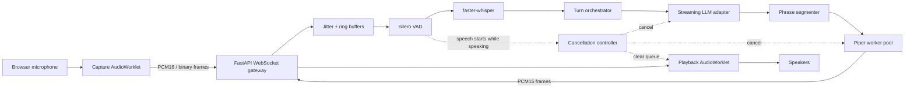

# SonicAgent

Self-hosted speech for products that should not send customer audio to a metered speech API.

SonicAgent transcribes speech and returns a WAV with one authenticated HTTP API. The same service runs on your own CPU and on a Hugging Face Docker Space. Audio and transcripts are not stored by default. There is no Google, Azure, or OpenAI speech key.

<p align="center">
  
</p>

<p align="center">
  <a href="https://huggingface.co/spaces/ruslanmv/SonicAgent">Voice Studio</a>
  ·
  <a href="https://github.com/ruslanmv/sonicagent/blob/plan/quest-voice-ollabridge-cloud/docs/roadmaps/quest-voice-ollabridge-cloud.md">Quest and OllaBridge plan</a>
  ·
  <a href="hf/README.md">Deploy locally or on Hugging Face</a>
</p>

## Where it creates impact

Teams adopt a speech stack when it is private, predictable, and cheap to run. SonicAgent is that layer:

- **Own the audio path.** Microphone audio goes to infrastructure you operate. The default is to discard the recording and the transcript after the response.
- **Remove the speech-API bill.** Recognition is multilingual Whisper Tiny on CPU. Speech is open Piper, not a per-character vendor.
- **One contract, two hosts.** Local Docker and the Hugging Face Space `ruslanmv/SonicAgent` serve the same routes. A product can start on Hugging Face and move to a private machine without a second client.
- **Voices for the product, not a demo gimmick.** Each supported locale has a female **Companion** profile (warmer, slower, for an adult companion) and a female **Secretary** profile (clearer, slightly faster, for work). These are published Piper voices with explicit synthesis settings. They are not a separate expressive-speech model, and they are not a claim about how a person should sound.

Use it for a support desk, a private assistant, a WebXR companion, or an internal tool that must keep recordings off a third-party speech vendor.

## What you can run today

| Capability | Status |
| --- | --- |
| Batch speech to text | Whisper Tiny, CPU INT8. English, Spanish, French, German, Italian, Portuguese. |
| Batch text to speech | Piper WAV. Female Companion and Secretary profiles, plus every other voice in the Hugging Face mirror, under its own language. |
| Voice Studio | Browser page on the Hugging Face Space and in the voice image. |
| Access control | Bearer token on `/v1/audio/*`. Optional bounded public demo, off unless you enable it. |
| Privacy defaults | No stored audio, no stored transcripts, no transcript text in logs. |
| Realtime calls, VAD, barge-in, streaming LLM | Designed. Not running. |

Portuguese listening works. The Portuguese voices in the mirror, Edresson and Faber, are male and stay labeled male. Voice Studio shows only the voices of the language you select: Italiano lists Paola and Riccardo, and Español lists Spanish voices.

## Voices

Source mirror: [`ruslanmv/hp-piper-voices`](https://huggingface.co/ruslanmv/hp-piper-voices). The selectable ids live in [`model_registry/voices.json`](model_registry/voices.json). The classified list, including what can be upgraded, is [`catalog/README.md`](catalog/README.md). `GET /v1/voices` returns the same library.

| Locale | Companion | Secretary |
| --- | --- | --- |
| English (US) | Kristin | Lessac |
| English (UK) | Cori | Alba |
| Spanish (Spain) | Sharvard, female speaker | Sharvard, female speaker |
| Spanish (Mexico) | Ald | Ald |
| French | Jessica | Siwis |
| German | Eva K, lighter model | Kerstin, lighter model |
| Italian | Paola | Paola |

Spain's Companion and Secretary profiles use speaker `F` of the two-speaker Sharvard model. The other Sharvard speaker is offered separately and labeled male. French Companion uses the Jessica speaker of the UPMC model. Pierre is the other speaker of that file and is labeled male. When a locale has one female voice, Companion and Secretary share that file and differ by pace and noise: Companion is slower and softer; Secretary is a little faster and steadier.

## Project status

Batch speech and a realtime turn both run. Neither one is a headset service level.

| Running now | Where |
| --- | --- |
| Batch transcription, Whisper Tiny, CPU INT8, six languages | `POST /v1/audio/transcriptions` |
| Batch Piper WAV, full voice mirror, Companion and Secretary presets | `POST /v1/audio/speech` |
| Voice Studio | `/` on the voice image and on the Space |
| Local voice image and the Space `ruslanmv/SonicAgent` | `hf/` |
| One measured HTTP pass against that Space | [`benchmarks/reports/hf-cpu-basic-endpoint-capability.md`](benchmarks/reports/hf-cpu-basic-endpoint-capability.md) |
| Realtime turn | `POST /v1/sessions` then `/v1/realtime/{id}`. Energy endpointing, barge-in, mock or OpenAI-compatible text, Piper phrases when a voice is ready. |

| Still open | State |
| --- | --- |
| Silero VAD | Not bundled. The running detector is energy endpointing. |
| Browser AudioWorklet | Scaffold. Voice Studio is the page that listens and speaks. |
| In-process telemetry | OpenTelemetry and Grafana files are templates. Turn metrics are events on the socket. |
| OllaBridge, Quest, and a service level | Cloud does not route audio. No headset test is claimed. |

The published timing report is one Linux client calling Hugging Face CPU Basic. It is not a Quest, phone, or glasses result. Finish the security checklist before calling a deployment production.

## Direction

A realtime turn accepts PCM frames, endpoints them, transcribes, streams text, and speaks phrases when Piper is ready. The browser AudioWorklet and Silero file are still not part of that path.

- Sessions use a random resume token. `development-token` is rejected.
- Energy endpointing, sequence checks, and barge-in cancellation run on the socket.
- `SONIC_LLM_PROVIDER=ollama` or `openai-compatible` streams from the configured base URL. The default provider is the local mock.
- Phrase audio is sent as PCM frames. The batch HTTP probe does not measure that path.

## Architecture



### Data plane

The initial protocol uses 20 ms PCM signed 16-bit little-endian frames. At 16 kHz mono, each frame contains 320 samples and 640 payload bytes. JSON text frames carry control events; binary frames carry audio.

### Control plane

A session progresses through explicit states:

```text
created → connecting → listening → transcribing → thinking → speaking
                                  ↘ interrupted → listening
                                  ↘ error → closing → closed
```

Each turn has a unique identifier and cancellation token. Old or cancelled turn output must never be played after a new turn begins.

## Repository layout

```text
src/sonicagent_rt/      Python service and provider interfaces
clients/web/            Browser AudioWorklet reference client
clients/python/         Python SDK scaffold
model_registry/         Voice/STT manifests, schemas, and checksums
benchmarks/             Stage, end-to-end, and concurrency benchmarks
configs/                Layered application profiles
deploy/                 Docker, proxy, and observability templates
hf/                     Local and Hugging Face voice image, scripts, and tests
docs/                   Architecture, protocol, ADRs, runbooks, security
examples/               Minimal browser and Python examples
tests/                  Unit, contract, integration, E2E, performance tests
.github/                 CI, security, release, and issue automation
```

A complete generated file map is available in [`PROJECT_TREE.md`](PROJECT_TREE.md), with architectural guidance in [`docs/architecture.md`](docs/architecture.md).

## Quick start

### Requirements

- Python 3.11 or newer.
- Node.js 20 or newer for the browser client.
- `uv` recommended for Python dependency management.
- Docker and Docker Compose are optional.

### Local development

```bash
git clone https://github.com/ruslanmv/sonicagent.git
cd sonicagent
cp .env.example .env
make bootstrap
make dev
```

`make dev` starts the mock API. It does not load Whisper or Piper. It exposes:

- API: `http://localhost:8000`
- OpenAPI: `http://localhost:8000/docs`
- Health: `http://localhost:8000/health/live`
- Readiness: `http://localhost:8000/health/ready`
- Browser client: `http://localhost:5173`

The default provider profile uses a deterministic mock LLM and does not download or execute neural models.

### Docker Compose

```bash
docker compose up --build
```

The root Compose file starts the API and web scaffold. The voice image, which runs Whisper Tiny and the Piper catalog on CPU, is separate:

```bash
docker compose -f hf/docker-compose.yml up --build
```

That serves `http://127.0.0.1:8000` and is documented in [`hf/README.md`](hf/README.md). The Voice Studio is the page at `/`. Realtime WebSocket audio and Silero VAD are not on this path. GPU access, Redis, Prometheus, Grafana, and OpenTelemetry remain templates under `deploy/`.

## Remaining work

Batch transcription, batch Piper, Voice Studio, the voice image, and one measured HTTP report are already in the tree. The realtime gateway is what remains:

1. **Protocol and sessions** — finalize JSON events, binary header, authentication, reconnect, sequence validation, queue limits, and golden fixtures.
2. **Browser media** — complete AudioWorklet capture/playback, resampling, echo handling, playback timestamps, and backpressure.
3. **VAD and endpointing** — integrate Silero ONNX, pre-roll, speech start/stop events, and noisy-room tests.
4. **LLM streaming** — implement OpenAI-compatible and Ollama clients with deadlines, retries, cancellation, and redacted telemetry.
5. **Phrase-pipelined playback and barge-in** — speak the first phrase before the full reply exists, then cancel that turn and clear queued audio.
6. **Per-stage telemetry** — measure VAD, endpointing, LLM time to first token, first audio, cancellation, and concurrency inside the process.
7. **Security and operations** — threat model, rate limiting, session isolation, secret handling, SBOM, signing, runbooks, and load testing.

## API overview

The speech routes are `POST /v1/audio/transcriptions` and `POST /v1/audio/speech`. They require a bearer token. The session and WebSocket sections below are the realtime design. `POST /v1/sessions` still returns a development token and does not start a voice turn.

### Create a session

```http
POST /v1/sessions
Content-Type: application/json
```

```json
{
  "language": "it",
  "voice_id": "it_IT-paola-medium",
  "input_audio": {
    "codec": "pcm_s16le",
    "sample_rate": 16000,
    "channels": 1,
    "frame_ms": 20
  },
  "client_capabilities": {
    "binary_audio": true,
    "barge_in": true,
    "partial_transcripts": false
  }
}
```

Example response:

```json
{
  "session_id": "ses_example",
  "resume_token": "development-token",
  "websocket_url": "/v1/realtime/ses_example",
  "expires_at": "2026-07-10T18:00:00Z",
  "server_capabilities": {
    "binary_audio": true,
    "barge_in": true,
    "partial_transcripts": false,
    "phrase_pipelined_tts": true
  },
  "output_audio": {
    "codec": "pcm_s16le",
    "sample_rate": 22050,
    "channels": 1
  }
}
```

### WebSocket

```text
/v1/realtime/{session_id}?resume_token=...
```

Client control events:

- `session.update`
- `input_audio.commit`
- `input_audio.clear`
- `response.cancel`
- `call.end`
- `ping`

Server events:

- `session.created`
- `session.updated`
- `speech.started`
- `speech.stopped`
- `transcript.partial`
- `transcript.final`
- `response.created`
- `response.text.delta`
- `response.text.done`
- `response.audio.started`
- `response.audio.done`
- `response.cancelled`
- `metrics.turn`
- `warning`
- `error`
- `pong`

## Binary audio frame v1

The scaffold reserves a 24-byte big-endian header:

| Offset | Size | Field |
|---:|---:|---|
| 0 | 2 | Magic bytes `SA` |
| 2 | 1 | Protocol version |
| 3 | 1 | Message type |
| 4 | 1 | Codec |
| 5 | 1 | Flags |
| 6 | 2 | Sample rate |
| 8 | 4 | Sequence number |
| 12 | 8 | Timestamp in microseconds |
| 20 | 4 | Payload length |
| 24 | N | Audio payload |

Message types: `0x01` microphone audio, `0x02` synthesized audio. Codec `0x01` is PCM S16LE. Opus is reserved for a later protocol version.

See [`docs/api/binary-frame.md`](docs/api/binary-frame.md) and the Python/TypeScript contract tests.

## Model registry

Neural model binaries are not stored in Git. The registry contains metadata, paths, checksums, licenses, and attribution.

Default voice mirror base:

```text
https://huggingface.co/ruslanmv/hp-piper-voices/resolve/main
```

Example model path pattern:

```text
{lang}/{locale}/{speaker}/{quality}/{voice_id}.onnx
{lang}/{locale}/{speaker}/{quality}/{voice_id}.onnx.json
```

The voice image downloads every voice in the registry during the build. Install the same files outside Docker with:

```bash
python hf/scripts/setup-models.py --model tiny --tts --cache-dir ~/.cache/sonicagent-rt
```

Each Piper file in the registry has a sha256. Whisper Tiny's `model.bin` checksum is pinned separately. The model cache should be a persistent volume in any deployment.

## Configuration

Copy `.env.example` and override values through environment variables or YAML profiles. Secrets must never be committed.

Important groups:

- `SONIC_SESSION_*`: lifecycle and concurrency limits.
- `SONIC_AUTH_*`: authentication and token settings.
- `SONIC_VAD_*`: speech threshold and endpointing.
- `SONIC_STT_*`: model, device, compute type, and language.
- `SONIC_LLM_*`: provider URL, model, token limit, timeout.
- `SONIC_TTS_*`: voice, workers, phrase limits, cache.
- `SONIC_BARGE_IN_*`: interruption thresholds and cancellation deadline.
- `SONIC_OTEL_*`: traces and metrics export.
- `SONIC_STORE_*`: privacy-sensitive persistence controls.

See [`docs/configuration.md`](docs/configuration.md).

## Latency and benchmark policy

SonicAgent is designed for measurable low-latency operation. Every report must document:

- Commit hash and dirty state.
- Date and operating system.
- CPU, RAM, GPU, driver, and power mode.
- VAD, STT, LLM, and TTS providers and model identifiers.
- Session count, utterance set, warm-up policy, and network conditions.
- P50, P95, P99, sample count, errors, and cancellations.

Required turn timestamps include speech start/stop, STT start/final, LLM request/first token, first phrase, TTS start, first audio, completion, barge-in detection, and audio cancellation.

`make benchmark-smoke` is a deterministic check. It does not call Whisper or Piper, and its latency fields are placeholders.

Measure a running speech API, including the Hugging Face Space, with `make benchmark-endpoints`. The probe records client-observed time for health, preset audio, synthesis, and transcription. The published pass is [`benchmarks/reports/hf-cpu-basic-endpoint-capability.md`](benchmarks/reports/hf-cpu-basic-endpoint-capability.md). See [`benchmarks/README.md`](benchmarks/README.md). Those figures describe that client and that host. They are not a VR headset result and not a service level.

## Testing

```bash
make lint
make typecheck
make test
make test-contract
make test-integration
make web-test
```

The test hierarchy is intentionally separated:

- **Unit:** pure algorithms, schemas, state machines, queues, segmentation.
- **Contract:** REST schemas, JSON events, binary protocol, Python/TypeScript parity.
- **Integration:** session lifecycle and provider orchestration using fakes.
- **E2E:** browser and real-model tests, normally opt-in.
- **Performance:** throughput, queue bounds, interruption deadlines, concurrency.

Placeholder tests are marked skipped where the production behavior does not exist yet. Replace skips with assertions as each module is implemented.

## Observability

The planned telemetry stack is OpenTelemetry-first:

- Structured JSON logs with session and turn IDs.
- Prometheus-compatible process and latency metrics.
- Distributed traces for ingress, VAD, STT, LLM, segmentation, TTS, and egress.
- Content redaction by default; transcript and audio storage disabled by default.
- Grafana dashboard scaffold under `deploy/observability/`.

Never attach raw audio, prompts, transcripts, API keys, or tokens to telemetry without an explicit, documented privacy mode.

## Security baseline

Before production deployment, complete the controls described in [`SECURITY.md`](SECURITY.md) and [`docs/security.md`](docs/security.md):

- TLS termination and secure WebSocket transport.
- Short-lived, audience-bound session tokens.
- Origin allowlist and authenticated session creation.
- Bounded payload size, frame rate, session duration, and concurrent sessions.
- Per-tenant isolation and rate limiting.
- No shell interpolation for model or provider arguments.
- Dependency, container, license, secret, and SBOM scanning.
- Redacted logs and opt-in storage.
- Threat-model review for untrusted audio, text, model files, and provider output.

The scaffold development token is not safe for public networks.

## Deployment profiles

- `deploy/compose/docker-compose.yml`: CPU baseline.
- `deploy/compose/docker-compose.gpu.yml`: GPU device reservation template.
- `deploy/compose/docker-compose.redis.yml`: shared session-store template.
- `deploy/compose/docker-compose.observability.yml`: collector, Prometheus, and Grafana.
- `deploy/proxy/nginx.conf`: WebSocket proxy and basic security headers.

Production deployments should pin image digests, use read-only filesystems where practical, run as non-root, mount models read-only, separate public and internal networks, and keep provider credentials in a secret manager.

## GitHub project setup

Recommended repository settings:

- Protect `main`; require pull requests, one approval, CODEOWNERS review, resolved conversations, and linear history.
- Require CI, protocol contract, web client, integration, registry, and container smoke checks.
- Enable CodeQL, Dependabot, dependency review, secret scanning, push protection, private vulnerability reporting, and OpenSSF Scorecard.
- Enable Discussions for benchmarks, model requests, architecture, and support.
- Do not make variable real-model benchmarks a merge-blocking check until dedicated benchmark hardware exists.

Suggested milestones:

1. `v0.1 Binary Audio Foundation`
2. `v0.2 VAD and STT`
3. `v0.3 LLM and Piper Pipeline`
4. `v0.4 Barge-In and Recovery`
5. `v0.5 Benchmark and Observability`
6. `v1.0 Stable Protocol`

## Definition of done for v1.0

Batch listening and speech for English, Spanish, French, German, Italian, and Portuguese already run once the voice files are installed. Companion and Secretary stay the female presets. Other speakers keep their published gender. v1.0 still requires the realtime path:

- Microphone PCM reaches the server through binary frames.
- Server-side Silero detects speech and endpointing behaves predictably.
- A realtime turn produces a faster-whisper transcript.
- LLM output is streamed and cancellable.
- Piper audio begins before the complete text response is generated.
- Barge-in cancels LLM and TTS work and clears queued playback.
- Queues remain bounded under slow clients and provider failures.
- Benchmark reports include reproducible hardware and configuration metadata.
- Protocol schemas are versioned and Python/TypeScript contract tests pass.
- Documentation, threat model, incident runbooks, SBOM, third-party notices, and release artifacts are complete.

## Known limitations of the planned v1 design

- faster-whisper does not provide native token-by-token streaming; rolling partial hypotheses are approximate and replaceable.
- Piper synthesis is phrase-pipelined rather than token-level waveform streaming.
- PCM is simple and deterministic but consumes substantially more bandwidth than Opus.
- Browser echo cancellation and microphone processing vary by browser, operating system, and hardware.
- End-to-end latency depends on endpointing settings, selected models, provider location, warm-up state, and compute hardware.
- Model source availability and licenses must be revalidated during release preparation.

## Architectural provenance and attribution

SonicAgent extracts and generalizes interaction patterns developed in HomePilot's voice-call subsystem, including authenticated WebSocket sessions, streamed assistant turns, turn identifiers, and cooperative cancellation.

The Piper browser integration and voice-selection experience draw from the 3D-Avatar-Chatbot project.

Voice model artifacts are intended to be downloaded from the `hp-piper-voices` preservation mirror maintained for the HomePilot ecosystem. The models originate from the open-source Piper voice collection. SonicAgent does not claim authorship or training of those models. Preserve original model cards, license files, and attribution when redistributing a deployment bundle.

See [`THIRD_PARTY_NOTICES.md`](THIRD_PARTY_NOTICES.md) for the release checklist.

## Contributing

Read [`CONTRIBUTING.md`](CONTRIBUTING.md), open or claim an issue, and keep pull requests limited to one architectural concern. Protocol changes require:

1. Updated Python and TypeScript definitions.
2. Updated JSON schemas and documentation.
3. Golden fixtures and compatibility tests.
4. A protocol version decision.
5. An ADR for breaking changes.

Performance pull requests must include before/after measurements on the same hardware and configuration.

## Support and security

- Usage questions and design discussions: GitHub Discussions.
- Reproducible bugs: GitHub Issues using the templates.
- Vulnerabilities: follow [`SECURITY.md`](SECURITY.md); do not open public security issues.

## License

The project is **GPL-3.0-or-later**. Batch Piper is part of the speech service. Before a public release, legal maintainers must confirm the final distribution model, dependency boundaries, model licenses, and notices.

Copyright holders retain rights to their original contributions and upstream artifacts.
