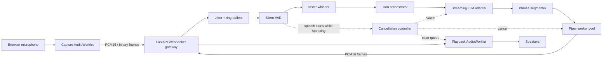

## Architecture



### Data plane

The initial protocol uses 20 ms PCM signed 16-bit little-endian frames. At 16 kHz mono, each frame contains 320 samples and 640 payload bytes. JSON text frames carry control events; binary frames carry audio.

### Control plane

A session progresses through explicit states:

```text
created → connecting → listening → transcribing → thinking → speaking
                                  ↘ interrupted → listening
                                  ↘ error → closing → closed
```

Each turn has a unique identifier and cancellation token. Old or cancelled turn output must never be played after a new turn begins.

## Repository layout

```text
src/sonicagent_rt/      Python service and provider interfaces
clients/web/            Browser AudioWorklet reference client
clients/python/         Python SDK scaffold
model_registry/         Voice/STT manifests, schemas, and checksums
benchmarks/             Stage, end-to-end, and concurrency benchmarks
configs/                Layered application profiles
deploy/                 Docker, proxy, and observability templates
docs/                   Architecture, protocol, ADRs, runbooks, security
examples/               Minimal browser and Python examples
tests/                  Unit, contract, integration, E2E, performance tests
.github/                 CI, security, release, and issue automation
```

A complete file map is available in [`docs/architecture.md`](docs/architecture.md).

