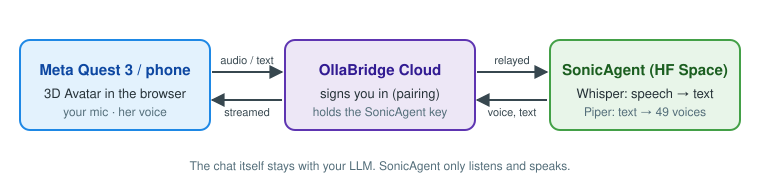

# SonicAgent with the 3D Avatar on Meta Quest 3

The [3D Avatar Chatbot](https://github.com/ruslanmv/3D-Avatar-Chatbot) uses SonicAgent to listen
(Whisper) and to speak (Piper, 49 voices). The headset only streams audio; the models run here.

## Set up the server (operator, once)

1. On this Space, set the secret `SONIC_API_KEY` (any long random string).
2. On the OllaBridge Cloud Space, set `OLLAMBRIDGE_VOICE_MODE=huggingface`,
   `OLLAMBRIDGE_VOICE_BASE_URL=https://ruslanmv-sonicagent.hf.space` and the secret
   `OLLAMBRIDGE_VOICE_API_KEY` = the same key. The key never reaches a browser.

## Use it (on the Quest 3)

1. Open the Avatar in the Quest Browser and pair OllaBridge in Settings ▸ LLM.
2. Settings ▸ TTS ENGINE = **SonicAgent Piper**; STT PROVIDER = **SonicAgent**, and tick
   **Allow microphone upload to SonicAgent**.
3. **ENTER VR**, hold the **right trigger**, speak, let go.

Step-by-step with screenshots: the Avatar's
[SonicAgent quick start](https://github.com/ruslanmv/3D-Avatar-Chatbot/blob/claude/awesome-brown-khqcdj/docs/SONICAGENT_QUICKSTART.md).

## Good to know

- A voice's first sentence takes 2–3 s while it loads; later replies start in 0.1–0.5 s.
- Speech sessions count against `SONIC_MAX_CONCURRENT_SESSIONS` (8, for the whole service). Only
  connected ones hold a place: a closed session is kept for 60 s and then gives way.
